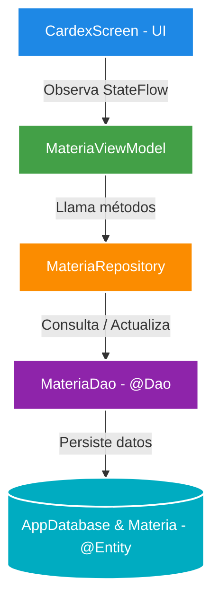

<div align="center">

  # 📱 Mi Cardex - Android App
  
  
  
  
  

  <p align="center">
    <b>Aplicación móvil nativa para la gestión y control reactivo de calificaciones y materias universitarias.</b>
    <br />
    <i>Desarrollada para la asignatura de Programación de Dispositivos Móviles para Android</i>
  </p>

  

</div>

---

## Características Principales

- **Cálculo Automático**: Obtención en tiempo real del promedio general y total de créditos cursados.
- **Persistencia Local**: Integración con **Room Database** para almacenar registros offline de manera segura.
- **UI Moderna**: Diseñada al 100% con **Jetpack Compose** y Material Design 3.
- **Arquitectura MVVM**: Separación limpia de responsabilidades mediante `Repository`, `ViewModel` y flujos de datos asíncronos (`Flow` / `StateFlow`).

---

## Tech Stack & Herramientas

<div align="left">

| Categoría | Tecnología |
| :--- | :--- |
| **Lenguaje** | `Kotlin` |
| **Interfaz (UI)** | `Jetpack Compose` & `Material 3` |
| **Base de Datos** | `Room Persistence Library` (SQLite) |
| **Arquitectura** | `MVVM` (Model-View-ViewModel) + `Repository Pattern` |
| **Async & Streams** | `Kotlin Coroutines` & `Flow` |

</div>

---

## Arquitectura de la Base de Datos

El módulo de base de datos implementa las anotaciones y bloques estructurales fundamentales de Room:



<details>
<summary><b>Ver detalle de los componentes de Room</b></summary>

- **`@Entity`**: Define la tabla `materias` con sus campos (`id`, `clave`, `nombre`, `creditos`, `calificacion`, `periodo`).
- **`@Dao`**: Métodos de acceso como `@Query`, `@Insert`, `@Update` y `@Delete`.
- **`@Database`**: Instancia Singleton que extiende de `RoomDatabase`.
- **`Repository`**: Aísla las fuentes de datos para el ViewModel.
- **`ViewModel`**: Sostiene los estados de la UI sobreviviendo a cambios de configuración.

</details>

---

## Cómo ejecutar el proyecto

1. **Clonar el repositorio:**
   ```bash
   git clone [https://github.com/AXEL3080/1174.1Mi-Cardex.git](https://github.com/AXEL3080/1174.1Mi-Cardex.git)
Abrir en Android Studio:

Selecciona Open an existing project.

Navega hasta la carpeta clonada.

Sincronizar Gradle & Ejecutar:

Deja que Gradle descargue las dependencias.

Selecciona un emulador o dispositivo físico con Android 8.0 (API 26) o superior y presiona Run (Shift + F10).

👤 Autor
Axel Gerardo Ramos

Ingeniería en Sistemas Computacionales

Tecnológico Nacional de México - Campus Tuxtla Gutiérrez

<div align="center">
  
</div>
